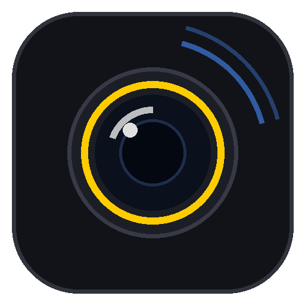

# Insta360 Studio Wireless (for ONE RS)

<p align="center">
  
</p>

<p align="center">
  <strong>Fast, wireless footage offloader & telemetry extractor with a sleek Google Photos-inspired Mica dark UI.</strong>
</p>

---

## ⚡ Releases & Portable Version

You can run **Insta360 Studio Wireless** immediately without installing the .NET runtime:
* **Standalone Portable Executable:** Download `Insta360StudioWireless-v1.0.0-Portable-win-x64.zip` from the Releases section, extract, and double-click `Insta360StudioWireless.exe`.
* **Standard Release:** Download `Insta360StudioWireless-v1.0.0-win-x64.zip`.

---

## Key Features

### 1. Google Photos Dark Mica UI
* Dark Mica glass backdrop with clean typography and modern pill action buttons.
* Fluid gallery view with live video previews, duration badges, and smooth hover animations.
* Floating connection prompt overlay that disappears once connected.
* Customizable storage location with an integrated folder browse picker button.

### 2. Manual Footage Gallery & On-Demand Offloader
* Connects directly to the camera's Wi-Fi Access Point (`192.168.42.1:6666`).
* **No forced auto-sync:** Browse videos and photos, inspect their size, duration, and metadata, and download only the clips you need.
* Chunked HTTP streaming with real-time transfer speed (`MB/s`), percentage progress, and ETA.

### 3. Fast Remote GPS & 6-Axis Gyro Telemetry Extraction
* Insta360 stores sensor data in a proprietary trailer at the very end of `.insv` containers.
* **Instant Remote Range Parsing:** Sends an HTTP Range request for the last 15–20 MB of the remote file on the camera. You can extract full GPS tracks and Gyro logs **without downloading the 30 GB video**.
* **Exports Supported:**
  * **GPX 1.1** (for Google Earth, Strava, Garmin, and GIS mapping).
  * **CSV** (for Gyroflow cinematic stabilization, Python, and Excel analysis).

### 4. Integrated Video Player with Live Gyro Attitude HUD
* Real-time synchronized 3D Gyroscope Attitude Indicator (dynamic artificial horizon tilt showing Pitch, Roll, and Yaw).
* YouTube / Google Photos style scrubber slider with smooth seek-on-drag and click-to-seek.
* Live telemetry overlay: Speedometer (km/h), Altitude (m), Satellites locked, and coordinates.

### 5. Built-in Auto-Detection & Fallback Mode
* Seamless connection state monitoring with visual status pills in the title bar.
* Works seamlessly both live with an Insta360 camera and locally with previously offloaded footage.

---

## How to Run & Build

### Prerequisites
* Windows 10 (21H2+) or Windows 11
* [.NET 8.0 SDK](https://dotnet.microsoft.com/download/dotnet/8.0)

### Quick Run via CLI
```powershell
cd D:\Insta360\Insta360StudioWireless
dotnet run
```

### Run Tests
```powershell
cd D:\Insta360\Insta360StudioWireless.Tests
dotnet test
```

### Visual Studio
Double-click `D:\Insta360\Insta360StudioWireless.sln` to open and build in Visual Studio 2022.

---

## Connecting to Your Insta360 ONE RS

1. Power on your Insta360 ONE RS and ensure Wi-Fi is enabled.
2. In Windows Settings, connect your PC's Wi-Fi adapter to the camera's hotspot:
   * **SSID:** `ONE RS XXXXXX` (or `Insta360-XXXXXX`)
   * **Default Password:** `88888888`
3. Launch the app and click **Connect** (Camera IP defaults to `192.168.42.1`, Port `6666`).
